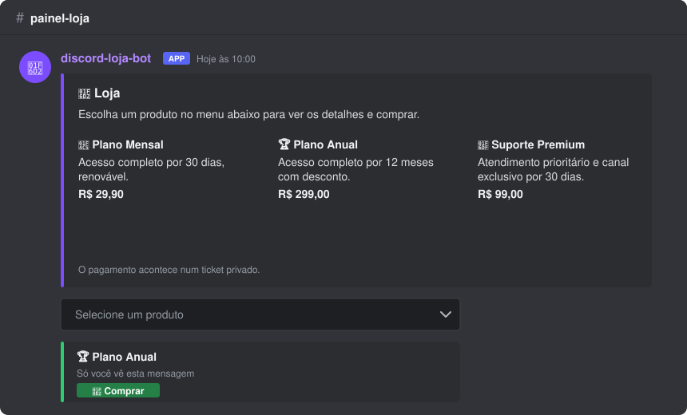
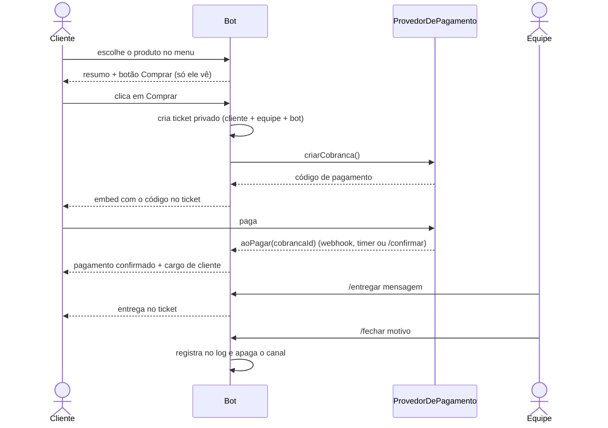

<p align="center"></p>

<h1 align="center">Shopkeep</h1>

<p align="center"><strong>a loja inteira dentro do seu servidor do Discord</strong></p>

<p align="center">Template de bot de loja: painel de produtos, ticket privado de compra, pagamento plugável e comandos da equipe.</p>

<p align="center">
  <a href="https://github.com/Dimasaas/shopkeep/actions/workflows/ci.yml"></a>
  
  
  
  
</p>

<p align="center"></p>

## O que faz

- **Painel de produtos** com menu de seleção, lido de `config/produtos.json`.
- **Botão Comprar** abre um **ticket privado**: um canal que só o comprador, a equipe e o bot enxergam.
- **Pagamento por interface** (`ProvedorDePagamento`), com uma implementação **falsa** para desenvolvimento: gera a cobrança e confirma por comando ou por timer.
- **Comandos da equipe**: `/entregar`, `/fechar`, `/painel` e `/confirmar` (só com o provedor falso).
- **`/setup` idempotente**: cria cargos, categorias, canais e publica (ou atualiza) o painel. Rodar de novo não duplica nada.
- **Tudo por `.env`**: token e IDs de servidor, canais e cargos. Só o `.env.example` é versionado.
- Testes com o cliente do Discord mockado: views, handlers, tickets, pagamento e setup.

Os produtos do exemplo (Plano Mensal, Plano Anual, Suporte Premium) são fictícios.

## Fluxo de compra



## Como rodar

### 1. Crie o aplicativo no Discord

1. Abra o [Developer Portal](https://discord.com/developers/applications) e clique em **New Application**.
2. Em **Bot**, clique em **Reset Token** e guarde o token (ele só aparece uma vez).
3. **Intents**: o bot usa apenas o intent `Guilds`, que já vem ligado. Não precisa de *Message Content* nem de *Server Members*.
4. Em **General Information**, copie o **Application ID**.
5. Convide o bot em **OAuth2 → URL Generator**: escopos `bot` e `applications.commands`; permissões **Manage Roles**, **Manage Channels**, **View Channels**, **Send Messages**, **Embed Links**, **Read Message History**.
6. Ligue o *Modo desenvolvedor* no Discord (Configurações → Avançado) e copie o ID do servidor (botão direito → Copiar ID).

> O cargo do bot precisa ficar **acima** dos cargos que ele cria e atribui (Equipe e Cliente) na lista de cargos do servidor.

### 2. Configure e suba

```bash
git clone https://github.com/Dimasaas/shopkeep.git
cd shopkeep
npm ci
cp .env.example .env     # preencha DISCORD_TOKEN, DISCORD_APP_ID e DISCORD_GUILD_ID
npm run dev
```

Sem os IDs do `/setup`, o bot sobe em **modo setup** e registra só o comando `/setup`.

### 3. Rode `/setup` no servidor

Quem tem permissão de administrador roda `/setup`. O bot cria o que falta e responde com as linhas para colar no `.env`:

```env
CATEGORIA_TICKETS_ID=...
CANAL_PAINEL_ID=...
CANAL_LOGS_ID=...
CARGO_EQUIPE_ID=...
CARGO_CLIENTE_ID=...
```

Cole no `.env`, reinicie, e os comandos completos aparecem. Use `/painel` em qualquer canal para publicar outro painel.

### Variáveis de ambiente

| Variável | Para quê |
|---|---|
| `DISCORD_TOKEN`, `DISCORD_APP_ID`, `DISCORD_GUILD_ID` | Aplicação e servidor |
| `CATEGORIA_TICKETS_ID` | Onde os tickets são criados |
| `CANAL_PAINEL_ID` | Canal do painel |
| `CANAL_LOGS_ID` | Log de pedidos (opcional) |
| `CARGO_EQUIPE_ID` | Quem vê os tickets e usa os comandos da equipe |
| `CARGO_CLIENTE_ID` | Cargo dado ao pagar (opcional) |
| `PAGAMENTO_PROVEDOR` | Qual provedor usar (`falso`) |
| `PAGAMENTO_FALSO_AUTO_SEGUNDOS` | Provedor falso confirma sozinho após N segundos (0 = só por `/confirmar`) |

## Produtos

Edite `config/produtos.json` (preço em centavos, até 25 produtos, limite do menu do Discord):

```json
{ "id": "plano-mensal", "nome": "Plano Mensal", "descricao": "Acesso completo por 30 dias.", "precoCentavos": 2990, "emoji": "📅" }
```

## Trocar o provedor de pagamento

O bot só conhece a interface em `src/pagamento/provedor.ts`:

```ts
export interface ProvedorDePagamento {
  readonly nome: string;
  criarCobranca(nova: NovaCobranca): Promise<Cobranca>;
  consultar(cobrancaId: string): Promise<StatusPagamento>;
  cancelar(cobrancaId: string): Promise<void>;
  aoPagar(ouvinte: (cobrancaId: string) => void | Promise<void>): void;
}
```

1. Crie `src/pagamento/meu-gateway.ts` implementando a interface. No `aoPagar`, guarde o ouvinte e chame-o quando o webhook do gateway confirmar o pagamento (valide a assinatura do webhook antes).
2. Registre em `src/pagamento/index.ts`, na função `criarProvedor`:
   ```ts
   case "meu-gateway":
     return new MeuGateway(/* credenciais lidas do ambiente */);
   ```
3. Defina `PAGAMENTO_PROVEDOR=meu-gateway` no `.env`.

O restante (ticket, cargo, `/entregar`) não muda. O comando `/confirmar` só existe quando o provedor é o falso. Os pedidos ficam em memória (`PedidosEmMemoria`); para persistir, implemente `RepositorioDePedidos` com o banco que preferir.

## Desenvolvimento

```bash
npm run build   # tsc
npm test        # vitest, cliente do Discord mockado
npm run dev     # tsx watch
```

Estrutura: `src/views.ts` (mensagens, funções puras), `src/handlers.ts` (interações), `src/staff.ts` (comandos da equipe), `src/tickets.ts` (canal privado e permissões), `src/setup.ts` (`/setup`), `src/pagamento/` (provedores).

## 🇺🇸 TL;DR

**Shopkeep** is a Discord shop bot template (TypeScript, discord.js v14): a product select panel, a **Buy** button that opens a private ticket channel (buyer + staff only), payments behind a `ProvedorDePagamento` interface with a **fake provider** for development, staff commands `/entregar` (deliver) and `/fechar` (close), and an **idempotent `/setup`** that creates roles, categories and channels. Everything (token, IDs) comes from `.env`; products are fictional and live in `config/produtos.json`. Fully tested with a mocked Discord client. Run `npm ci && npm run dev`, then `/setup` in your server. UI strings are in Portuguese (pt-BR).

## Licença

Código aberto para leitura e estudo. Uso livre para **estudo, pesquisa e projetos pessoais ou sem fins comerciais**, sob a [PolyForm Noncommercial 1.0.0](LICENSE). **Uso comercial só com autorização do autor.**

© 2026 João Victor Diamantino Cardoso
